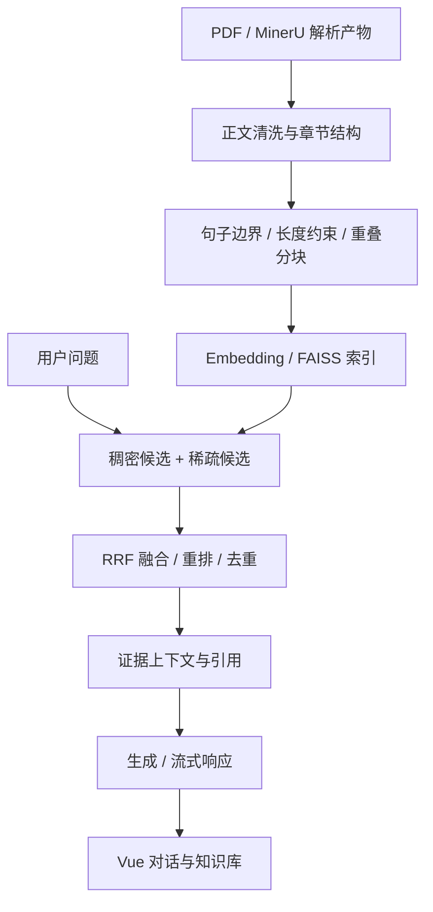

# AssistGen · 文档问答与 Agent 应用

面向教材与技术资料的全栈 AI 助手，围绕文档清洗、结构化分块、混合检索、引用生成和评测组织 RAG 链路。

[](https://github.com/casset23/assistgen/actions/workflows/ci.yml)


[界面](#界面与预览) · [轻量复现](#先复现文档分块) · [RAG 设计](#rag-链路与设计取舍) · [完整运行](#完整后端) · [验证](#验证与评测)

## 为什么做这个项目

长文档问答的困难常出现在模型调用之前：目录和页眉混入正文、章节被切散、相似片段挤占候选，以及回答缺少出处。本项目把这些问题拆到独立模块中，让解析、分块、检索与生成可以分别检查。

应用层包含聊天、会话管理、知识库上传与切换；RAG 层包含 MinerU 结果处理、FAISS 索引、稠密与稀疏候选融合、重排和引证生成。当前处于个人应用原型阶段，完整数据库与真实模型联调仍需验证。

**技术栈：Vue 3、TypeScript、FastAPI、LangGraph、FAISS、MySQL、Redis。** GraphRAG 和 Neo4j 属于代码中的扩展路径，轻量分块示例不依赖它们。

## 界面与预览


上图是项目自身的 `/preview` 页面，使用明确标记的合成资料，展示知识库列表、文档状态和索引信息。它不发送业务请求、不修改用户知识库，也不创建真实向量索引。新建、上传和对话操作在预览中禁用。

```bash
git clone https://github.com/casset23/assistgen.git
cd assistgen/frontend/DsAgentChat_web
npm ci
npm run dev
```

打开终端显示地址的 `/preview` 路径，即可查看页面。正常 `/chat`、`/knowledge` 和其他业务页面保留原登录要求，需要后端服务。

## 先复现文档分块

下面这条路径调用项目原有 `MinerUBookRAGService`，只读取已经解析好的 Markdown，不下载 OCR、Embedding 或语言模型，也不启动数据库。

Python **3.11+**，在仓库根目录执行：

```bash
python -m venv .venv
# Windows: .venv\Scripts\activate
# macOS/Linux: source .venv/bin/activate
python -m pip install loguru==0.7.3
python scripts/chunk_mineru.py examples/mineru-demo --output data/demo-chunks.json
python -m unittest discover -s tests -v
```

预期终端结果：

```text
1 chunks -> data/demo-chunks.json
```

示例是短篇合成工程资料，默认配置下得到一个 chunk；这个数量只用于复现数据流，不代表检索质量指标。结果包含：

```json
{
  "chunk_id": 1,
  "section_title": "第一章 缓存与请求治理",
  "title_level": 1,
  "start_page": 1,
  "end_page": 1,
  "char_count": 269,
  "text": "第一章 缓存与请求治理……"
}
```

上面省略了正文，完整实际输出见 [分块结果](docs/examples/demo-chunks.json)。Markdown 无真实分页时页码来自估计；具备 `content_list_v2.json` 时，代码尝试按文本匹配回填页范围，引用仍需核对原文。

## RAG 链路与设计取舍



| 环节 | 实现 | 解决的问题与边界 |
| --- | --- | --- |
| 文档清洗 | 页眉页脚、目录、图表与正文启发式处理 | 减少噪声；规则可能误删正文，需要覆盖回归样例 |
| 章节组织 | 章、节与编号标题归一化，正文聚合 | 保留主题上下文；目前有教材格式假设 |
| 分块 | 长度配置、递归切分、句子边界与尾部重叠 | 控制上下文长度；长度以字符衡量，不是 Token 预算保证 |
| 出处信息 | 章节、页范围、chunk ID | 帮助定位证据；自动回填页码不是人工校对结果 |
| 检索 | FAISS 稠密检索、稀疏词项候选、RRF 融合 | 同时利用语义与关键词；需标注集比较配置 |
| 重排 | 规则特征与可配置 cross-encoder 路径 | 增加相关性判断；引入模型与计算成本 |
| 生成 | 证据组织、流式输出与引用处理 | 保留出处；尚无公开真实问答效果报告 |

主要 RAG 源码位于 `backend/deepseek_agent/llm_backend/app/services/`。建议从分块进入，再读检索和生成，最后看应用编排。

### 分块配置的约束

[chunking_config.json](backend/deepseek_agent/llm_backend/app/services/book_rag/chunking_config.json) 默认值：

| 参数 | 默认值 | 含义 |
| --- | ---: | --- |
| `min_chunk_length` | 320 | 小块合并参考阈值 |
| `target_chunk_length` | 1100 | 目标长度 |
| `max_chunk_length` | 1500 | 常规分块上限参数 |
| `chunk_soft_limit` | 1620 | 软边界参数 |
| `chunk_overlap` | 120 | 尾部重叠参数 |

加载时要求严格整数，并满足 `0 < min <= target <= max <= soft_limit`、`0 <= overlap < target`。非法顺序、布尔值和小数会在处理文档前被拒绝。实际输出长度还受句子与合并策略影响，不能把配置值当作所有 chunk 的硬保证。

### 本次实际修复

在复现仓库示例时发现，以“并发限制”开头的完整段落被首字“并”命中续句规则，随后作为残句丢失。新增回归测试先复现正文缺失，再调整完整句段判断，使这一段和等待队列说明保留到最终 chunk。

此外增加了切分参数校验和只读预览入口。改动直接改善可复现性与内容保真，未引入虚构检索分数或示例答案。

## 完整后端

完整依赖较重，建议使用独立 Python **3.11** 环境。轻量脚本验证成功不意味着以下集成已通过。

```bash
cd backend/deepseek_agent
python -m pip install -r requirements.txt
# 将仓库根 .env.example 复制至 llm_backend/.env 并填写本地配置
cd llm_backend
python -m scripts.init_db
python -m uvicorn main:app --host 127.0.0.1 --port 8000
```

| 依赖 | 用途 | 配置入口 |
| --- | --- | --- |
| MySQL | 用户、会话等应用数据 | `DB_*` |
| Redis | 缓存等应用依赖 | `REDIS_*` |
| 模型服务 | 对话、生成和向量化 | `DEEPSEEK_*`、`OLLAMA_*` 等 |
| 本地签名密钥 | 应用认证 | 随机设置 `SECRET_KEY` |
| Neo4j / GraphRAG | 图工具扩展路径 | 按启用功能配置 |

`Settings` 从 `llm_backend/.env` 读取变量。前端通过 Vite 代理访问后端，地址以其配置文件为准。首次完整服务启动、数据库迁移和模型组合仍需按本地环境联调。

| 接口 | 用途 |
| --- | --- |
| `GET /health` | 存活检查 |
| `POST /api/chat` | 流式聊天 |
| `POST /api/upload` | 上传与索引 |
| `POST /api/book-rag/index` | Book RAG 建索引 |
| `POST /api/book-rag/retrieve` | 检索证据 |
| `POST /api/book-rag/generate` | 引证生成 |

请求字段以运行后的 `/docs` 和 [main.py](backend/deepseek_agent/llm_backend/main.py) 为准。初次使用须上传自己的文档建立索引，历史前端预置索引标识不代表当前后端已存在该索引。

## 验证与评测

```bash
# 仓库根目录：无需模型、OCR 和数据库
python -m unittest discover -s tests -v

# 前端目录
npm run type-check
npm run build
```

| 已执行检查 | 覆盖范围 | 本次结果 |
| --- | --- | --- |
| Python unittest | Markdown 分块/保存、配置合法性、完整段落保留 | 4 个测试方法通过，含 8 组非法配置子用例 |
| CLI 示例 | 读取合成资料、输出结构化 JSON | 通过 |
| Vue 类型与构建 | 前端类型及生产资源 | 通过 |
| 浏览器页面 | 无后端访问 `/preview`，业务按钮禁用 | 已复现 |

[CI](https://github.com/casset23/assistgen/actions) 执行前端检查及上述轻量分块路径。测试主动阻止加载 OCR 和 torch，避免把模型下载当作单元测试前提。

仓库保留解析、检索、生成与组合评测脚本，但公开版没有真实语料、标注集、索引和评测结果。完整数据库集成、PDF/OCR、真实召回与答案质量尚未完成本轮验证。见 [验证记录](docs/VERIFICATION.md)。

## 源码导览

以下后端路径相对 `backend/deepseek_agent/llm_backend/`：

| 文件 / 目录 | 阅读重点 |
| --- | --- |
| `app/services/book_rag/mineru_book_rag_service.py` | 清洗、章节、分块、页码与配置验证 |
| `app/services/book_rag/document_parser_service.py` | 文档解析服务 |
| `app/services/embedding_service.py` | 索引、候选融合与重排 |
| `app/services/book_rag_chat_service.py` | 上下文、回答与引用 |
| `main.py`、`app/services/` | API、会话与模型编排 |
| `evaluate_*` | 各环节评测入口 |
| `frontend/DsAgentChat_web/src/views/KnowledgeBaseView.vue`（仓库根） | 知识库界面与只读预览 |

## 常见问题与公开范围

| 问题 | 处理方向 |
| --- | --- |
| 只想看项目，安装完整依赖过重 | 先运行轻量 CLI 和前端 `/preview` |
| Markdown 有结果，PDF 不能解析 | PDF/OCR 是额外依赖路径，分别检查解析环境 |
| 分块配置报错 | 核对严格整数与参数顺序，不要用小数或布尔值 |
| 已打开页面但无法问答 | 检查登录、后端、数据库、模型和真实索引 |

[Microsoft GraphRAG](https://github.com/microsoft/graphrag) 通过固定版本依赖接入，当前版本不附带其整份源码或测试数据。公开版不包含企业 GRPO/LoRA 训练代码、企业评测数字、教材原文、聊天记录、模型凭据和本地索引。

开发期接口鉴权、文件路径边界与用户数据隔离仍需整体审查，目前按可信本地原型使用。下一步优先固定完整依赖矩阵，补小型人工标注检索集，对相同问题集比较配置，并验证端到端引证。仓库未授予额外开源许可，第三方依赖遵循各自许可证。
