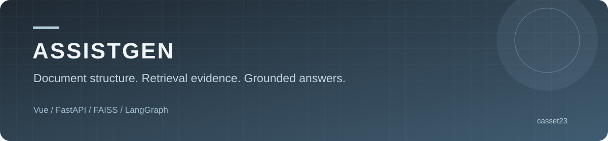
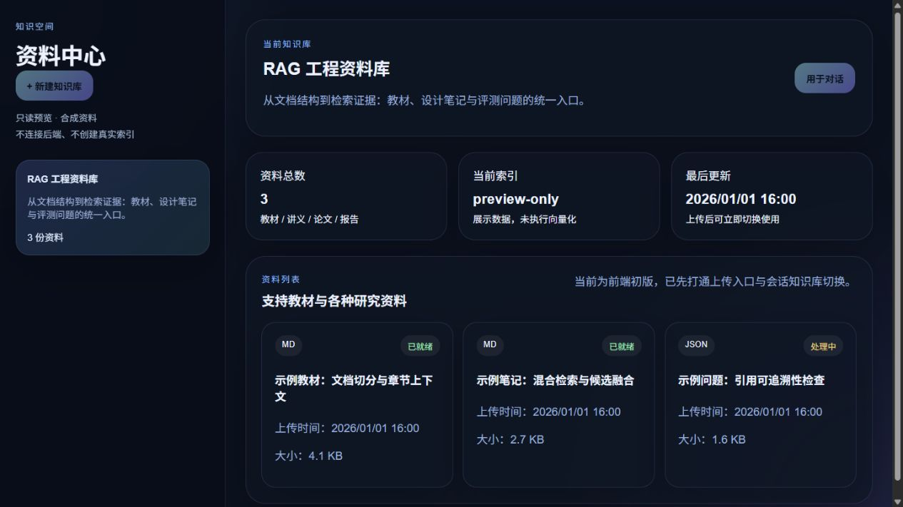
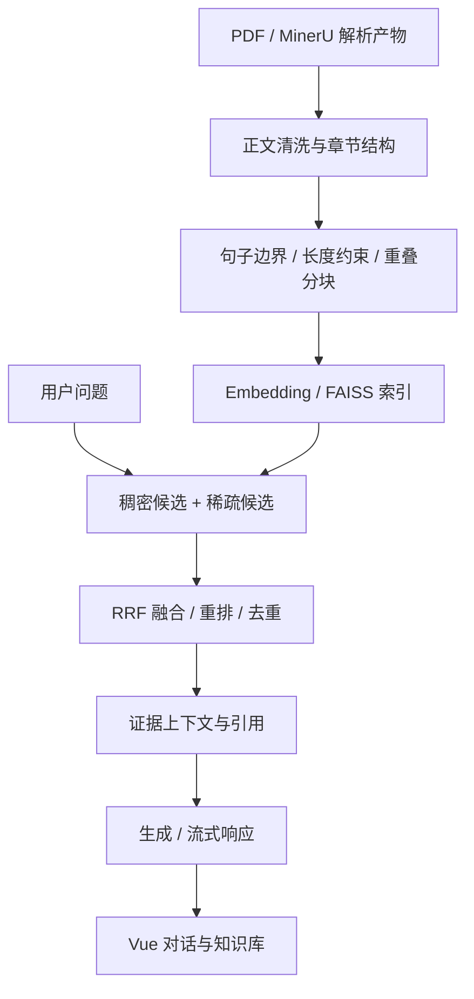

# AssistGen · 文档问答与 Agent 应用

面向教材与技术资料的全栈 AI 助手，围绕文档清洗、结构化分块、混合检索、引用生成和评测组织 RAG 链路。

[](https://github.com/casset23/assistgen/actions/workflows/ci.yml)


[界面](#界面与预览) · [轻量复现](#先复现文档分块) · [RAG 设计](#rag-链路与设计取舍) · [完整运行](#完整后端) · [验证](#验证与评测)

## 为什么做这个项目

长文档问答的困难常出现在模型调用之前：目录和页眉混入正文、章节被切散、相似片段挤占候选，以及回答缺少出处。本项目把这些问题拆到独立模块中，让解析、分块、检索与生成可以分别检查。

应用层包含聊天、会话管理、知识库上传与切换；RAG 层包含 MinerU 结果处理、FAISS 索引、稠密与稀疏候选融合、重排和引证生成。各环节通过独立服务、配置和脚本组织，支持从文档预处理到应用交互的分层开发。

**技术栈：Vue 3、TypeScript、FastAPI、LangGraph、FAISS、MySQL、Redis。**

## 界面与预览



`/preview` 提供知识库界面的只读预览，展示资料列表、文档状态和索引信息。页面使用内置示例数据，无需登录和后端服务；上传与问答从正常业务页面进入。

```bash
git clone https://github.com/casset23/assistgen.git
cd assistgen/frontend/DsAgentChat_web
npm ci
npm run dev
```

打开终端显示地址的 `/preview` 路径，即可查看页面。正常 `/chat`、`/knowledge` 和其他业务页面保留原登录要求，需要后端服务。

## 先复现文档分块

下面这条路径调用 `MinerUBookRAGService`，直接读取已解析的 Markdown，只需安装日志依赖即可执行。

Python **3.11+**，在仓库根目录执行：

```bash
python -m venv .venv
# Windows: .venv\Scripts\activate
# macOS/Linux: source .venv/bin/activate
python -m pip install loguru==0.7.3
python scripts/chunk_mineru.py examples/mineru-demo --output data/demo-chunks.json
python -m unittest discover -s tests -v
```

预期终端结果：

```text
1 chunks -> data/demo-chunks.json
```

示例文档围绕缓存、请求超时与并发控制展开，默认配置下输出一个 chunk，包含章节、页范围、长度与正文：

```json
{
  "chunk_id": 1,
  "section_title": "第一章 缓存与请求治理",
  "title_level": 1,
  "start_page": 1,
  "end_page": 1,
  "char_count": 269,
  "text": "第一章 缓存与请求治理……"
}
```

完整输出见 [分块结果](docs/examples/demo-chunks.json)。页码处理支持 Markdown 分页估计和 `content_list_v2.json` 文本对齐回填，两条路径共享同一 chunk 结构。

## RAG 链路与设计取舍



| 环节 | 实现 | 设计重点 |
| --- | --- | --- |
| 文档清洗 | 页眉页脚、目录、图表与正文启发式处理 | 降低噪声干扰，并用正文保留回归约束规则 |
| 章节组织 | 章、节与编号标题归一化，正文聚合 | 按教材章节结构保留主题上下文 |
| 分块 | 字符长度配置、递归切分、句子边界与尾部重叠 | 在长度与语义连贯性之间控制切分边界 |
| 出处信息 | 章节、页范围、chunk ID | 将检索证据关联到文档位置 |
| 检索 | FAISS 稠密检索、稀疏词项候选、RRF 融合 | 同时利用语义与关键词；需标注集比较配置 |
| 重排 | 规则特征与可配置 cross-encoder 路径 | 增加相关性判断；引入模型与计算成本 |
| 生成 | 证据组织、流式输出与引用处理 | 让回答携带可定位的证据来源 |

主要 RAG 源码位于 `backend/deepseek_agent/llm_backend/app/services/`。建议从分块进入，再读检索和生成，最后看应用编排。

### 分块配置的约束

[chunking_config.json](backend/deepseek_agent/llm_backend/app/services/book_rag/chunking_config.json) 默认值：

| 参数 | 默认值 | 含义 |
| --- | ---: | --- |
| `min_chunk_length` | 320 | 小块合并参考阈值 |
| `target_chunk_length` | 1100 | 目标长度 |
| `max_chunk_length` | 1500 | 常规分块上限参数 |
| `chunk_soft_limit` | 1620 | 软边界参数 |
| `chunk_overlap` | 120 | 尾部重叠参数 |

加载时要求严格整数，并满足 `0 < min <= target <= max <= soft_limit`、`0 <= overlap < target`。非法顺序、布尔值和小数会在处理文档前被拒绝。句子边界与小块合并策略共同决定最终输出长度。

### 正文保留与规则回归

清洗规则区分完整句段与 OCR 残句：即使段落以“并发”“其中”等词开头，完整长句仍保留在正文中。回归用例检查“并发限制”段落及等待队列说明能够进入最终 chunk。

参数校验在文档处理前执行，正文保留检查在最终 chunk 上执行，分别覆盖配置入口与处理结果。

## 完整后端

完整服务使用独立 Python **3.11** 环境，按下表准备数据库、缓存和模型服务。

```bash
cd backend/deepseek_agent
python -m pip install -r requirements.txt
# 将仓库根 .env.example 复制至 llm_backend/.env 并填写本地配置
cd llm_backend
python -m scripts.init_db
python -m uvicorn main:app --host 127.0.0.1 --port 8000
```

| 依赖 | 用途 | 配置入口 |
| --- | --- | --- |
| MySQL | 用户、会话等应用数据 | `DB_*` |
| Redis | 缓存等应用依赖 | `REDIS_*` |
| 模型服务 | 对话、生成和向量化 | `DEEPSEEK_*`、`OLLAMA_*` 等 |
| 本地签名密钥 | 应用认证 | 随机设置 `SECRET_KEY` |
| Neo4j / GraphRAG | 图工具扩展路径 | 按启用功能配置 |

`Settings` 从 `llm_backend/.env` 读取变量。前端通过 Vite 代理访问后端，地址以其配置文件为准。首次启动时检查数据库连接、模型名称和本地索引路径。

| 接口 | 用途 |
| --- | --- |
| `GET /health` | 存活检查 |
| `POST /api/chat` | 流式聊天 |
| `POST /api/upload` | 上传与索引 |
| `POST /api/book-rag/index` | Book RAG 建索引 |
| `POST /api/book-rag/retrieve` | 检索证据 |
| `POST /api/book-rag/generate` | 引证生成 |

请求字段见运行后的 `/docs` 和 [main.py](backend/deepseek_agent/llm_backend/main.py)。上传文档并建立索引后，将返回的 `index_id` 用于检索与生成请求。

## 验证与评测

```bash
# 仓库根目录：无需模型、OCR 和数据库
python -m unittest discover -s tests -v

# 前端目录
npm run type-check
npm run build
```

| 检查 | 覆盖范围 | 结果 |
| --- | --- | --- |
| Python unittest | Markdown 分块/保存、配置合法性、完整段落保留 | 4 个测试方法通过，含 8 组非法配置子用例 |
| CLI 示例 | 读取示例文档、输出结构化 JSON | 通过 |
| Vue 类型与构建 | 前端类型及生产资源 | 通过 |
| 浏览器页面 | 无后端访问 `/preview`，业务按钮禁用 | 已复现 |

[CI](https://github.com/casset23/assistgen/actions) 执行前端检查及上述轻量分块路径。测试主动阻止加载 OCR 和 torch，避免把模型下载当作单元测试前提。

评测脚本按解析、检索、生成与组合评估拆分。执行时提供文档、索引和标注问题，可分别定位解析噪声、候选相关性与引证生成问题。测试命令与用例见 [测试说明](docs/VERIFICATION.md)。

## 源码导览

以下后端路径相对 `backend/deepseek_agent/llm_backend/`：

| 文件 / 目录 | 阅读重点 |
| --- | --- |
| `app/services/book_rag/mineru_book_rag_service.py` | 清洗、章节、分块、页码与配置验证 |
| `app/services/book_rag/document_parser_service.py` | 文档解析服务 |
| `app/services/embedding_service.py` | 索引、候选融合与重排 |
| `app/services/book_rag_chat_service.py` | 上下文、回答与引用 |
| `main.py`、`app/services/` | API、会话与模型编排 |
| `evaluate_*` | 各环节评测入口 |
| `frontend/DsAgentChat_web/src/views/KnowledgeBaseView.vue`（仓库根） | 知识库界面与只读预览 |

## 常见问题

| 问题 | 处理方向 |
| --- | --- |
| 只想看项目，安装完整依赖过重 | 先运行轻量 CLI 和前端 `/preview` |
| Markdown 有结果，PDF 不能解析 | PDF/OCR 是额外依赖路径，分别检查解析环境 |
| 分块配置报错 | 核对严格整数与参数顺序，不要用小数或布尔值 |
| 已打开页面但无法问答 | 检查登录、后端、数据库、模型和真实索引 |

[Microsoft GraphRAG](https://github.com/microsoft/graphrag) 通过固定版本依赖接入，图工具按功能需要配置 Neo4j 与 GraphRAG 工作区。
