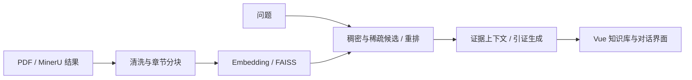

# AssistGen · 文档问答与 Agent 应用

围绕文档解析、可追溯分块、混合检索和引证生成构建的全栈 AI 助手。

**Vue 3 · TypeScript · FastAPI · LangGraph · FAISS · MySQL · Redis**

[](https://github.com/casset23/assistgen/actions/workflows/ci.yml)

## 项目重点

文档问答需要处理解析噪声、章节上下文、相似片段干扰和答案出处。本项目把解析、分块、检索、生成及评测分别组织为模块，便于定位问题和调整配置。

当前是个人应用原型，包含聊天、会话管理、知识库界面、RAG 接口及评测脚本。本仓库不包含企业多模态 RAG 的 GRPO/LoRA 训练代码或内部评测数据，不将企业实验指标作为本项目实测结果。



| 环节 | 关注点 | 代码 |
| --- | --- | --- |
| 文档预处理 | 页眉页脚、图表、目录和章节边界 | `app/services/book_rag/document_parser_service.py` |
| 结构化分块 | MinerU `full.md` / `content_list_v2.json`、独立配置 | `app/services/book_rag/mineru_book_rag_service.py` |
| 检索 | 向量检索、稀疏候选融合、去重与上下文整理 | `app/services/embedding_service.py` |
| 生成 | 证据组织、流式返回与引用处理 | `app/services/book_rag_chat_service.py` |
| 评测 | 解析、检索、生成和组合评估脚本 | `evaluate_*` |
| 应用后端 | 会话持久化、模型工厂、日志中间件 | `main.py`、`app/services/` |

表中路径相对于 `backend/deepseek_agent/llm_backend/`。代码存在不代表对应集成已经完成运行验证。

## 轻量复现：先跑分块

Python 3.11+，不需要模型 Key、OCR 模型或数据库：

```bash
python -m venv .venv
# Windows: .venv\Scripts\activate
# macOS/Linux: source .venv/bin/activate
python -m pip install loguru==0.7.3
python scripts/chunk_mineru.py examples/mineru-demo --output data/demo-chunks.json
python -m unittest discover -s tests -v
```

示例文字为合成内容。测试阻止加载 PDF/OCR 和 torch，检查 Markdown 分块与结果保存；PDF 解析需要额外依赖。

## 前端

Node.js 20+：

```bash
cd frontend/DsAgentChat_web
npm ci
npm run dev
npm run type-check
npm run build
```

登录、聊天和知识库操作依赖后端。页面构建成功不代表端到端问答验证通过。

## 完整后端

```bash
cd backend/deepseek_agent
python -m pip install -r requirements.txt
# 将仓库根目录 .env.example 复制到 llm_backend/.env 并填写
cd llm_backend
python -m scripts.init_db
python -m uvicorn main:app --host 127.0.0.1 --port 8000
```

准备 MySQL 数据库、Redis 和模型服务；Ollama 路径需下载配置模型，图工具还需 Neo4j。完整依赖较重，建议独立的 Python 3.11 环境，首次完整服务运行仍需集成验证。

`Settings` 从 `llm_backend/.env` 读取变量。填写随机 `SECRET_KEY`、数据库和模型凭据；示例配置不能用于线上部署。

| 接口 | 用途 |
| --- | --- |
| `GET /health` | 存活检查 |
| `POST /api/chat` | 流式聊天 |
| `POST /api/upload` | 上传和索引 |
| `POST /api/book-rag/index` | Book RAG 索引 |
| `POST /api/book-rag/retrieve` | 检索 |
| `POST /api/book-rag/generate` | 生成 |

以本地 `/docs` 和 `main.py` 为准。评测脚本需要自行准备文档、索引和标注问题，公开仓库不提供真实教材或企业语料。

## 依赖与公开范围

[Microsoft GraphRAG](https://github.com/microsoft/graphrag) 通过 `graphrag==2.1.0` 依赖安装；新版不再打包其完整源码、测试数据和生成索引。需要 GraphRAG 工作区时使用其初始化命令创建，设置 `GRAPHRAG_PROJECT_DIR`；不要把上游源码放进应用目录。

发布版排除了密钥、聊天数据、PDF 原文、解析产物和本地索引。Git 提交历史保留，当前目录清理不等于清理了历史。

已验证：前端类型检查及构建、合成 Markdown 分块测试、Python 语法检查。待验证：完整数据库与模型集成、PDF/OCR、真实检索效果。开发期 CORS、接口鉴权和文件路径边界仍需整体安全审查，当前仅在可信本地环境运行。

下一步：固定完整后端依赖矩阵，补充小型标注检索集，检查用户数据隔离，并在相同问题集上比较检索配置。
